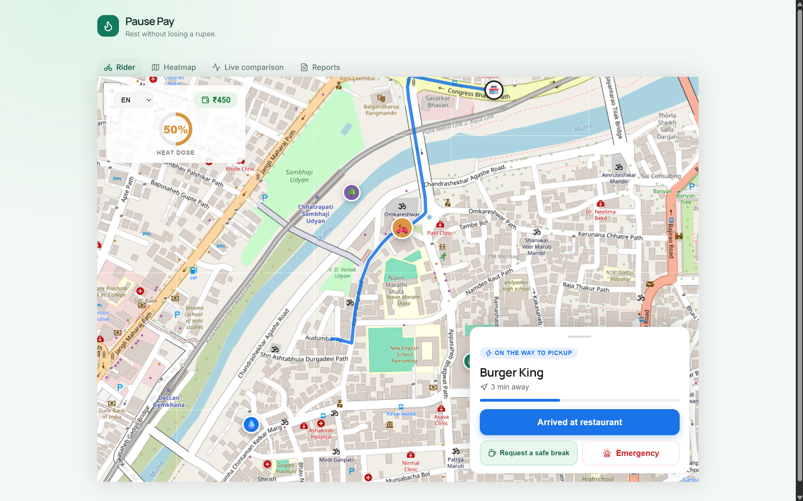
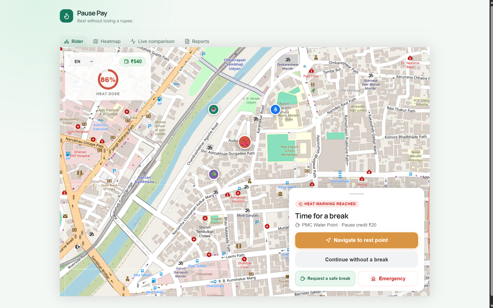
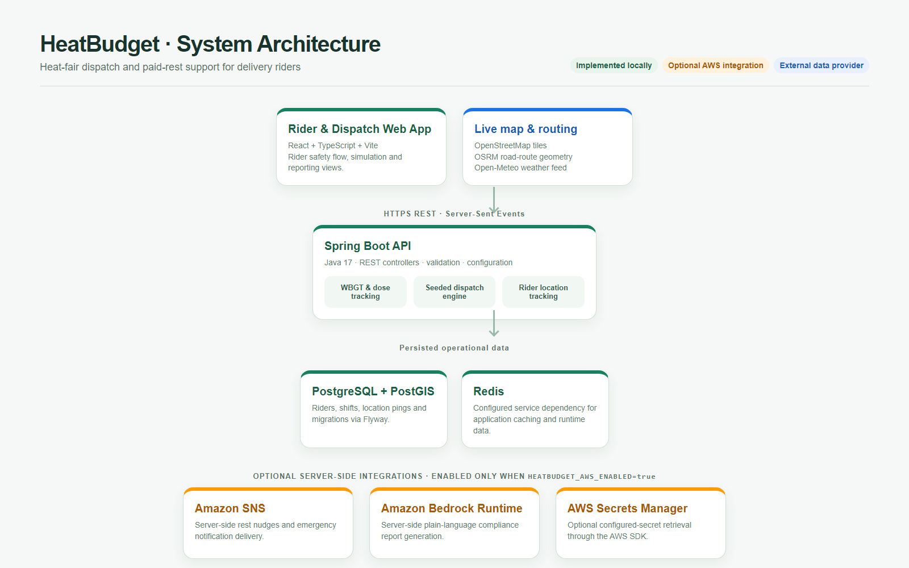

# HeatBudget

> Heat-aware dispatch and paid recovery breaks for delivery riders.

HeatBudget turns heat safety into an operational decision. It tracks a rider's heat dose, compares ordinary dispatch with a heat-aware alternative, recommends recovery stops, and records the paid-break support needed to make rest practical.

<p align="center">
  
  
</p>

## What it does

- Gives riders a safety-first view of their current heat dose, delivery state, and recovery guidance.
- Simulates the difference between nearest-rider dispatch and a heat-aware dispatch policy on the same seeded scenario.
- Supports consented shift and location tracking, heat-dose guidance, SOS/rest nudges, and pause-credit calculations.
- Shows live comparison routes on actual road geometry, including a recovery stop, rather than drawing a straight line between points.
- Generates operational and compliance-oriented reporting from the backend.

## System architecture



The diagram reflects the checked-in project, not a proposed cloud design. The live comparison map currently uses **OpenStreetMap** tiles, **OSRM** road routing, and **Open-Meteo** weather data.

## AWS services used — honestly

AWS integration is optional and server-side. It is enabled only when `HEATBUDGET_AWS_ENABLED=true` and valid AWS credentials and resource identifiers are supplied.

| Service | What the code uses it for | Status |
| --- | --- | --- |
| Amazon SNS | Sends rest nudges and emergency notifications through the Spring Boot service. | Implemented, optional |
| Amazon Bedrock Runtime | Produces plain-language compliance reports from the Spring Boot service. | Implemented, optional |
| AWS Secrets Manager | Reads an optional configured secret through the AWS SDK. | Implemented, optional |
| Amazon Location Service | Not used by the current checked-in live-map path. | Not in current runtime |
| AWS Amplify | Not configured as this repository's hosting/runtime path. | Not in current runtime |

Credentials never belong in the frontend. The backend uses the AWS SDK default credential provider chain, so use an IAM role in deployment or a local AWS profile while developing.

## Tech stack

| Area | Tools |
| --- | --- |
| Rider and dispatch UI | React, TypeScript, Vite, React Leaflet |
| API | Java 17, Spring Boot, REST, Server-Sent Events |
| Data | PostgreSQL + PostGIS, Redis, Flyway |
| Map and weather data | OpenStreetMap, OSRM, Open-Meteo |
| Optional cloud services | Amazon SNS, Amazon Bedrock Runtime, AWS Secrets Manager |

## Run locally

### 1. Start PostgreSQL and Redis

```bash
copy .env.example .env
docker compose --env-file .env up -d
```

### 2. Start the API

```bash
mvn spring-boot:run
```

The API starts on port 8080 by default.

For a self-contained demo without Docker, run the in-memory H2 profile instead:

```bash
mvn spring-boot:run -Dspring-boot.run.profiles=demo
```

The demo API listens on port 9090 and does not persist rider data after it stops.

### 3. Start the frontend

```bash
cd frontend
npm install
npm run dev
```

Open the URL Vite prints, normally `http://localhost:5173`.

## Optional AWS configuration

Keep `HEATBUDGET_AWS_ENABLED=false` for the default local experience. To exercise the implemented integrations, set the relevant values in your local environment or `.env`:

```env
HEATBUDGET_AWS_ENABLED=true
AWS_REGION=ap-south-1
AWS_SNS_TOPIC_ARN=...
AWS_BEDROCK_MODEL_ID=...
AWS_SECRET_ID=...
```

The service only needs the fields required for the feature you invoke. Configure AWS credentials outside the repository, for example with an IAM role or AWS CLI profile.

## API highlights

| Endpoint | Purpose |
| --- | --- |
| `GET /api/v1/status` | Service health/status |
| `GET /api/v1/weather/current` | Current weather and WBGT screening estimate |
| `GET /api/v1/sim/scenario?seed=440026` | Reproducible simulation input |
| `POST /api/v1/dispatch/compare` | Baseline versus heat-aware dispatch comparison |
| `GET /api/v1/dispatch/events` | Live Server-Sent Event updates |
| `POST /api/v1/riders/shifts` | Begin a consented rider-tracking shift |
| `POST /api/v1/riders/{riderId}/location` | Submit an idempotent location ping |
| `GET /api/v1/riders/{riderId}/dose` | Retrieve heat dose and guidance |

## Practical guardrails

- Location tracking should begin only with rider consent and should be limited to the active shift.
- Rest breaks should be non-punitive; pause credits are intended to keep safety from reducing take-home pay.
- The WBGT and heat-dose model is a screening and decision-support tool, not medical advice.
- Public map, routing, and weather providers need network access. The UI includes graceful fallbacks for backend/demo availability, but production should use monitored, rate-limit-aware providers.
