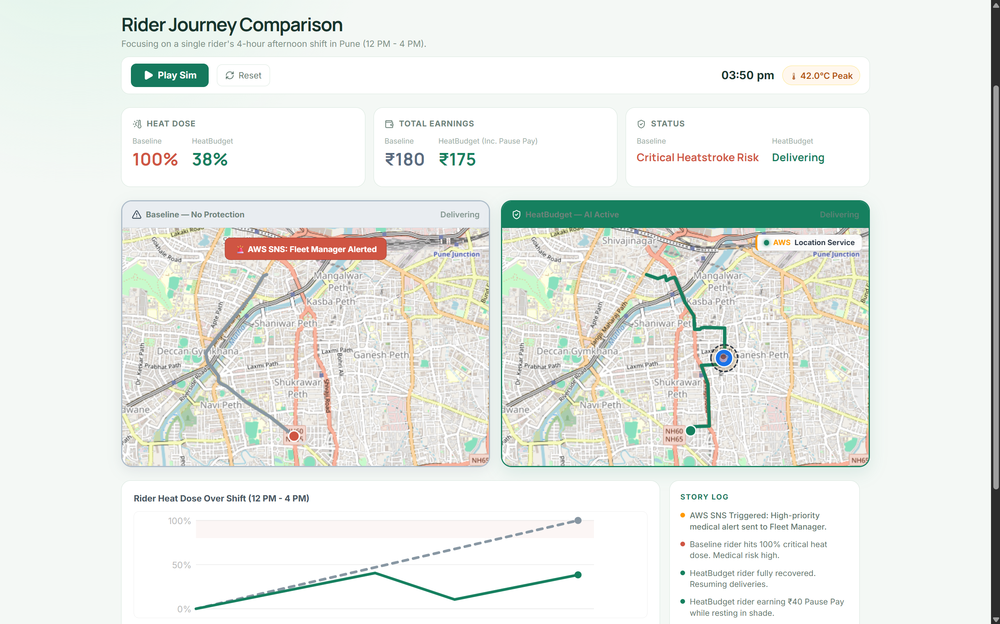

# HeatBudget

### Algorithm-driven heat protection and "Pause Pay" for delivery fleets

> Same orders. Same weather. Fewer riders pushed past a safe heat limit.



---

## Table of Contents

- [Problem Statement](#problem-statement)
- [Objective](#objective)
- [Solution Overview](#solution-overview)
- [Key Features](#key-features)
- [Screenshots](#screenshots)
- [Technical Architecture and Stack](#technical-architecture-and-stack)
- [Setup and Run](#setup-and-run)
- [Limitations and Next Steps](#limitations-and-next-steps)

---

## Problem Statement

Think about a delivery rider on a 44°C afternoon in Pune.

They have been on the road since morning. They are paid per delivery, so there is no salary and no paid break. When the phone buzzes with an order, they take it, because declining or going offline can mean losing incentives and income they were counting on. Much of their day is not even spent riding. They stand outside restaurants in direct sun, waiting for food to be packed, and that waiting time is unpaid.

Heat does not hit all at once. It builds through the shift as fatigue, dizziness and dehydration. Riders carry on, often until something goes wrong.

Today's tools do not help. Weather apps say "it's hot." Dispatch systems assign the nearest rider and never ask how much heat that rider has already absorbed. Rest points are fixed locations that do not adapt to who needs them right now. Rules on outdoor work exist, but there is no practical way to apply them during dispatch, or to check afterwards whether they were followed.

The result is a choice no worker should have to make: protect your health or protect your income.

## Objective

Make safety and earnings work together instead of against each other. HeatBudget treats heat as a budget:

1. **Track what actually builds up.** Estimate each rider's cumulative heat dose over the shift, not just the temperature at one moment.
2. **Cut the heat that earns nothing.** Reduce unpaid time in the sun by guiding riders to shaded waiting spots.
3. **Share heat fairly.** Assign orders and routes to reduce total exposure while keeping earnings and delivery times close to normal.
4. **Make rest affordable.** Guide riders to the nearest rest point and calculate a Pause Pay credit so resting does not mean losing income. Limits are soft: the rider stays in control and can choose to keep working.
5. **Help when it matters.** Alert fleet managers when a rider reaches their limit or presses SOS.
6. **Make safety checkable.** Generate aggregate compliance reports for platforms and regulators, with rider-level data kept private.

**Success metric:** fewer riders over the heat limit at similar earnings and delivery time, compared with baseline nearest-rider dispatch on the same seeded day.

**What this is not:** a medical device or a replacement for rest and hydration. It is a decision-support tool that helps platforms make safer choices.

## Solution Overview

HeatBudget is a dispatch interceptor that monitors rider heat exposure. When a rider approaches a critical limit, the engine routes them to a recovery point and calculates a financial **Pause Pay** credit to offset income lost while resting.

A seeded simulator replays the same day twice, once with baseline nearest-rider dispatch and once with HeatBudget dispatch, so the difference comes from the algorithm alone.

## Key Features

| Feature | What it does |
|---|---|
| **Rider View** | Mobile UI showing live heat dose, route shading, and nearby rest stops |
| **Dispatch Comparison** | Dual simulation of baseline dispatch vs. HeatBudget algorithm-assisted dispatch |
| **Pause Pay** | Calculates financial incentives based on time spent in a designated rest geofence |
| **SOS Alerts** | Manual and automated emergency triggers that push alerts to Fleet Managers |
| **Reports** | Dashboard generating aggregate KPI compliance reports |
| **Multilingual UI** | English and Hindi switching |

## Screenshots

### Dispatch comparison (judges' view)


### Rider view

| Waiting for pickup | Time to rest |
|:---:|:---:|
|  |  |
| Heat-aware guidance to a shaded waiting spot | Nearest rest point with Pause Pay amount |

---

## Technical Architecture and Stack

### Architecture diagram



The Mermaid diagram is included as the project architecture visual. The current live comparison path uses OpenStreetMap tiles, OSRM road routing, and Open-Meteo weather data.

### 1. Frontend and Simulation (React / TypeScript)

- **Framework:** React 18 with TypeScript, bundled via Vite.
- **Mapping:** `react-leaflet` rendering OpenStreetMap raster tiles, with OSRM fetching real-world road geometries.
- **Simulation:** a React animation loop calculates coordinates along the OSRM route, including the recovery stop.
- **Fallback strategy:** client-side mock data can keep the demo usable when the backend is offline.

### 2. Cloud Integrations (Amazon Web Services)

The checked-in backend has optional AWS integrations. They are enabled only with `HEATBUDGET_AWS_ENABLED=true`, valid server-side credentials, and the relevant resource identifiers:

| AWS service | Project use | Status |
|---|---|---|
| **Amazon SNS** | Server-side rest nudges and emergency notifications | Implemented, optional |
| **Amazon Bedrock Runtime** | Server-side plain-language compliance-report generation | Implemented, optional |
| **AWS Secrets Manager** | Optional secret retrieval through the AWS SDK | Implemented, optional |
| **Amazon Location Service** | Not used by the current live-map path | Not in current runtime |
| **AWS Amplify** | Not configured as this repository's hosting path | Not in current runtime |

AWS credentials must never be supplied to Vite or committed into the frontend. The Spring Boot service uses the AWS SDK default credential provider chain, so use an IAM role when deployed or a local AWS profile while developing.

### 3. Backend (Java / Spring Boot)

- **Framework:** Java 17 and Spring Boot 3.4.
- **Database:** PostgreSQL with PostGIS and Flyway migrations.
- **Caching and runtime data:** Redis.
- **Testing and demo mode:** H2 in-memory database.
- **API:** REST endpoints, rider tracking, seeded simulations, and Server-Sent Events.

---

## Setup and Run

### Prerequisites

- Java 17
- Maven 3.9+
- Node.js 18+
- Docker (optional, for PostgreSQL and Redis)

### 1. Backend with Docker (PostgreSQL + Redis)

1. Copy `.env.example` to `.env` and replace the local passwords.
2. Start the data services:

   ```bash
   docker compose --env-file .env up -d
   ```

3. Start the API:

   ```bash
   mvn spring-boot:run
   ```

### 1b. Backend without Docker (demo mode)

If Docker, PostgreSQL, or Redis are unavailable, run the API with an in-memory H2 database:

```bash
mvn spring-boot:run -Dspring-boot.run.profiles=demo
```

> This listens on port `9090` and does not keep rider data after the process stops.

### 2. Frontend

```bash
cd frontend
npm install
npm run dev
```

> **Never commit `.env` files.** Configure AWS credentials outside the frontend; use an IAM role or local AWS profile for optional backend integrations.

### 3. Quick check

- API health: `http://localhost:9090/api/v1/status` (demo mode)
- Seeded comparison: open the dashboard and press **Play** on seed `440026`

---

## Limitations and Next Steps

**Current limitations (honest list)**

- **Optional AWS configuration:** SNS, Bedrock, and Secrets Manager require backend configuration and credentials; they are off by default.
- **Mock data fallbacks:** if the Spring Boot backend is offline, the frontend can fall back to client-side mock data for the demo.
- **Simulated orders:** riders and orders are generated by a seeded simulator. Weather data is real; the order stream is not.
- **Heat-dose math:** the current simulation uses a simplified model. WBGT values are screening estimates, not measurements.
- **Decision support only:** HeatBudget is not a medical device and makes no diagnosis.

**Next steps**

- Implement a cumulative dose model with decay and recovery.
- Validate WBGT thresholds with occupational-health experts.
- Pilot with anonymized real order patterns from a rider union or platform partner.
- Add a rider-side companion mode to cover riders working across multiple platforms.
- Keep platform reports aggregate-only, with rider-level dose visible only to the rider.

---

## Sources

- Newslaundry, “Piping hot: India's delivery economy runs on worker heat stress” (May 2026)
- South First, “Heatwave warnings, but no relief” (2026)
- WRI India, “Rising heat's invisible burden on delivery workers”
- Rest of World, “India heat wave delivery workers” (2024)
